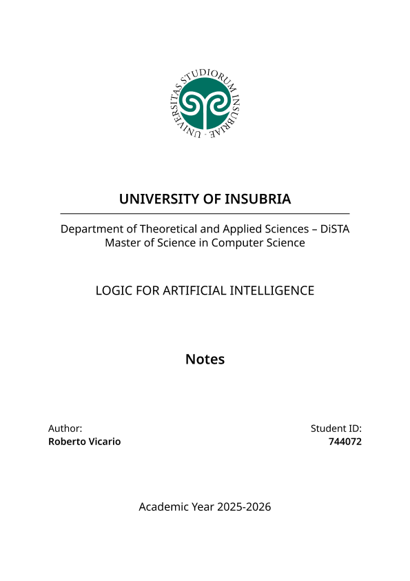

|  |
| - |

# [Course_Name], [BSc_MSc_PhD] Course @ [Your_University]

This repository contains my personal materials for the [Course_Name] course at the [Your_University], part of the [BSc_MSc_PhD] in [Faculty_Name].

## Overview

You can download my personal materials using the link below. To create your own materials, simply fork this repository and start editing using markdown.

## Prerequisites

> [!IMPORTANT]
>
> - Pandoc

## Materials

| <a href="https://raw.githubusercontent.com/robertovicario/uninsubria-LOGIC_AI/main/dist/Notes.pdf"></a> | <a href="https://raw.githubusercontent.com/robertovicario/uninsubria-LOGIC_AI/main/dist/Project-Work.pdf"></a> |
| - | - |

## Instructions

Usage:

```sh
bash cmd.sh {setup|notes|project}
```

### `setup`

If you haven't built the project yet, you can do so by running:

```sh
bash cmd.sh setup
```

### `notes`

The script will automatically generate the `Notes.pdf` file from the markdown files located in the `docs/md` directory and merge it with your `front-1.pdf` to create the final `Notes.pdf`:

```sh
bash cmd.sh notes
```

> [!IMPORTANT]
>
> Before running this command, ensure to upload your own `front-1.pdf` into the `dist` directory. You can even let `pandoc` generate a title page for you by updating the `titlepage` field in the `docs/md/__metadata__.yml` file, and removing the `front-1.pdf` reference from the `cmd.sh` script.

### `project`

Same mechanism applies to the `Project-Work.pdf` file, which is generated with the `project` command:

```sh
bash cmd.sh project
```

## License

This project is distributed under [GNU General Public License version 3](https://opensource.org/license/gpl-3-0). You can find the complete text of the license in the project repository.
